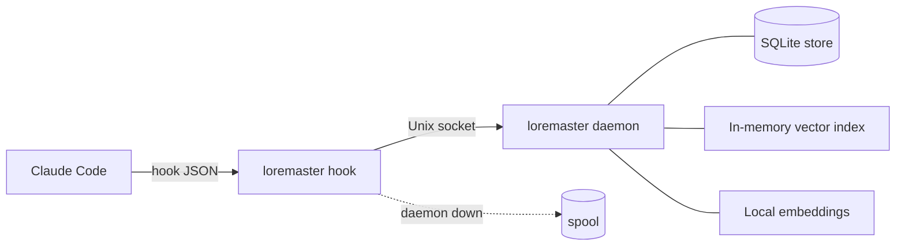

<p align="center">
  
</p>

<p align="center">
  <a href="https://github.com/mAzurkovic/loremaster/actions/workflows/ci.yml"></a>
  <a href="Cargo.toml"></a>
  <a href="rust-toolchain.toml"></a>
  <a href="LICENSE"></a>
  <a href="#status"></a>
  
  
</p>

<p align="center">
  <b>Your AI agent remembers you on every machine.</b><br>
  Memory lives locally on each of your devices and syncs through the cloud. You never manage it.
</p>

---

> [!WARNING]
> **Loremaster is pre-alpha and is not ready for everyday use.** Only the local client exists today. Cross-device sync and automatic memory extraction are not built yet, so memories can only be added with a development command. See [Status](#status).

## Why Loremaster?

Agents already keep memory, but that memory is stuck on one machine:

- **Switch machines and your agent forgets you.** Preferences, corrections, project facts and past attempts stay behind.
- **Memory dies with the machine.** A reformat or a lost laptop loses it.
- **Each agent keeps its own memory.** A fact told to one agent is unknown to another, even on the same device.

Copying `~/.claude` around with file sync tools can corrupt live databases and lose concurrent edits. Hosted memory APIs are cloud-only, so they add network latency to recall and stop working offline.

Loremaster takes a different approach: **recall is local and fast, and the cloud is only used to sync.**

## Features

| Feature | Status |
|---|---|
| **Profile at session start:** a short briefing of your key user and project facts | ✅ Available |
| **Recall on every prompt:** local semantic search injects only relevant memories | ✅ Available |
| **Project scoping:** project facts stay in their project, user preferences apply everywhere | ✅ Available |
| **Secret redaction:** gitleaks rules, built-in rules and your own patterns, applied before a turn is stored | ✅ Available |
| **Fail-safe hooks:** if Loremaster is down or slow, your agent carries on and no turn is lost | ✅ Available |
| **Turn capture:** each turn is condensed, redacted and queued in a local database | ✅ Available |
| **Automatic extraction:** durable facts and session summaries, with no manual saving | 🚧 Planned |
| **Cross-device sync:** works offline and in parallel, and memories converge on every device | 🚧 Planned |
| **GitHub login and one-command setup** | 🚧 Planned |
| **Codex CLI support** | 🚧 Planned, after the first release |

## How it works

Agent hooks call a thin `loremaster` CLI, which talks to a long-running daemon over a Unix socket. The daemon holds the local store, the embedding model and the vector index.



| Agent event | What Loremaster does |
|---|---|
| `SessionStart` | Injects a profile of up to 300 estimated tokens |
| `UserPromptSubmit` | Injects relevant memories, up to 500 estimated tokens, or nothing if none match |
| `Stop` | Captures the turn, redacts it and queues it |
| `SessionEnd` | Captures anything left and marks the session as ended |

For example, the agent sees this at session start:

```text
Loremaster memory from past sessions. Newer user instructions override it.
User:
- [preference] Prefers pnpm over npm
Project github.com/acme/web:
- [decision] Deploys go through ArgoCD, not manual kubectl
```

Later milestones add a thin AWS service for sync, login and extraction. Recall will stay on the device. See the [design](specs/loremaster/design.md) for the full architecture.

## Quick start

There are no prebuilt binaries yet, so you build from source. This walkthrough runs in a sandbox and does not touch your real agent configuration.

**You need:**

- macOS on Apple Silicon, or Linux on x86_64 (with AVX2) or arm64
- [rustup](https://rustup.rs), which installs the pinned toolchain automatically, and a C compiler
- `sqlite3` and `nc`, used by the try-out script

```sh
git clone https://github.com/mAzurkovic/loremaster.git
cd loremaster
cargo build --features dev

# Keep everything away from your real ~/.loremaster
export LOREMASTER_HOME=/tmp/lm-sandbox

# Start the daemon. The first start downloads the embedding model (about 64 MB).
./target/debug/loremaster daemon &

# Add sample memories, then send one sample event for each hook
./target/debug/loremaster dev seed scripts/samples.jsonl
./scripts/try-hook.sh
```

The output shows exactly what an agent would receive, followed by the turns that were queued. A token in a sample `git clone` command appears as `[REDACTED:github-pat]`.

The first `dev seed` can take a minute or two, because it also needs the embedding model.

### Connect Claude Code

> [!CAUTION]
> This edits your real `~/.claude/settings.json`. Until extraction exists, Loremaster only recalls memories you seed by hand, and captured turns wait in the queue. There is no `uninstall` command yet, so to remove Loremaster, delete its hook entries from that file.

```sh
unset LOREMASTER_HOME
./target/debug/loremaster enable claude-code
./target/debug/loremaster daemon &
```

The daemon does not start by itself yet, so you need to start it again after a reboot. While it is down, hooks exit silently and Claude Code works as normal.

## Configuration

Loremaster keeps everything in `~/.loremaster/`. Set `LOREMASTER_HOME` to use a different location.

To redact your own patterns, add them to `~/.loremaster/config.toml`. Changes apply without a restart.

```toml
[redact]
patterns = ["ACME-[0-9]{8}"]
```

## Privacy and security

**Today**

- Memories and queued turns stay on your device. Recall runs entirely locally.
- The only network call the code makes at runtime is the embedding model download from a pinned Hugging Face commit, checked against a SHA-256 hash.
- Turns are redacted before they are stored. Redaction uses 222 pinned gitleaks rules, built-in rules for what those miss, and your own patterns.
- `store.db` is not encrypted by Loremaster, so turn on full-disk encryption. Claude Code's own transcripts are also stored unencrypted and unredacted on disk.

**Planned**

Once sync and extraction ship, these will leave your device over TLS:

- **Memories** will be stored on the service so that your devices can sync.
- **Redacted, condensed turns** will be sent to the service for extraction with Claude Haiku.

Embedding vectors will never sync, because each device computes its own.

## Roadmap

| Milestone | Delivers | Status |
|---|---|---|
| **M1. Local client core** | Daemon, hooks, recall, capture and redaction on one device | ✅ Merged |
| **M2. Identity and service** | AWS stack and GitHub device-flow login | 🚧 In progress |
| **M3. Sync** | Memories converge across devices, offline and in parallel | Not started |
| **M4. Extraction** | Facts and session summaries captured automatically | Not started |
| **M5. Setup and lifecycle** | One-command install, `status`, `update`, `uninstall` and account deletion | Not started |

Details are in [`milestones.md`](specs/loremaster/milestones.md).

## Status

Loremaster is in active early development. Commands, file formats and storage may change without notice. There are no releases yet, and the targets below are requirements, not published benchmarks.

| Target (at 50k memories) | Limit |
|---|---|
| Added latency for recall on each prompt (P95) | 100 ms |
| Added latency for capture (P95) | 50 ms |

To measure them on your machine, run `cargo run --release --features dev -- dev bench`.

## Development

```sh
cargo fmt --all --check
cargo clippy --locked --workspace --all-targets --all-features -- -D warnings
cargo test --locked --workspace --all-features
```

The `dev` feature enables the `dev seed` and `dev bench` commands, and is off in normal builds. Tests download the embedding model on their first run.

```text
crates/
  loremaster/         CLI and daemon
  loremaster-agents/  One adapter per agent (Claude Code today)
  loremaster-core/    Shared record, ULID and hybrid logical clock types
scripts/              Sample memories and the hook try-out script
specs/loremaster/     Requirements, design and milestones
```

The project is too early for a formal contribution process. To report a bug or discuss an idea, please [open an issue](https://github.com/mAzurkovic/loremaster/issues). The [requirements](specs/loremaster/requirements.md) and [design](specs/loremaster/design.md) explain what is being built and why.

## Why the name?

Inspired by Lord Elrond, who himself is a Loremaster in Rivendell who has knowledge over several ages of Middle-earth.

## License

Loremaster is released under the [MIT License](LICENSE).

It bundles the default [gitleaks](https://github.com/gitleaks/gitleaks) rules, which are also MIT licensed. See [their license](crates/loremaster/src/gitleaks.LICENSE).
