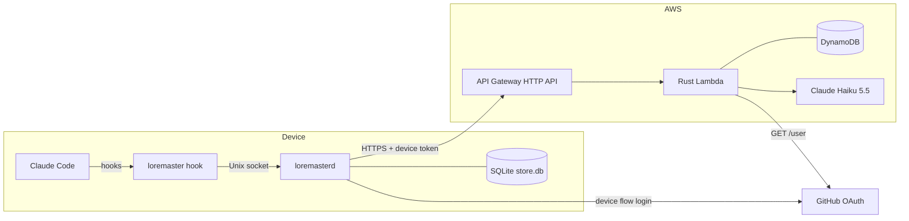
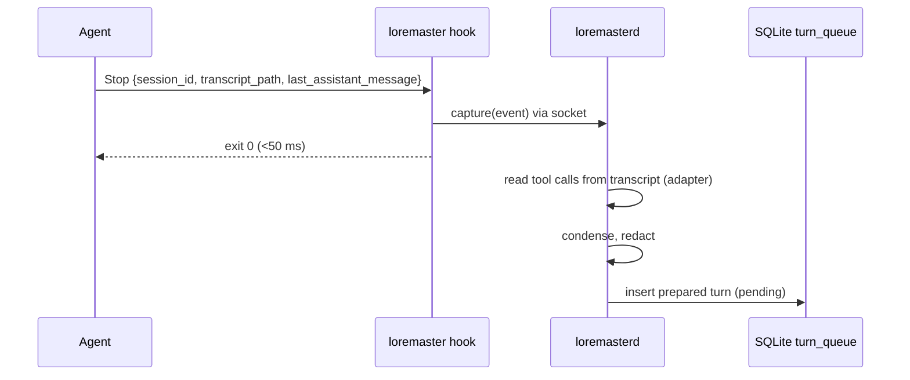
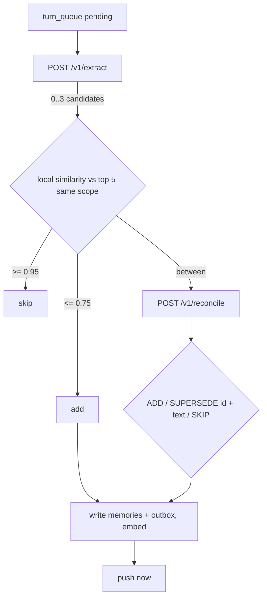
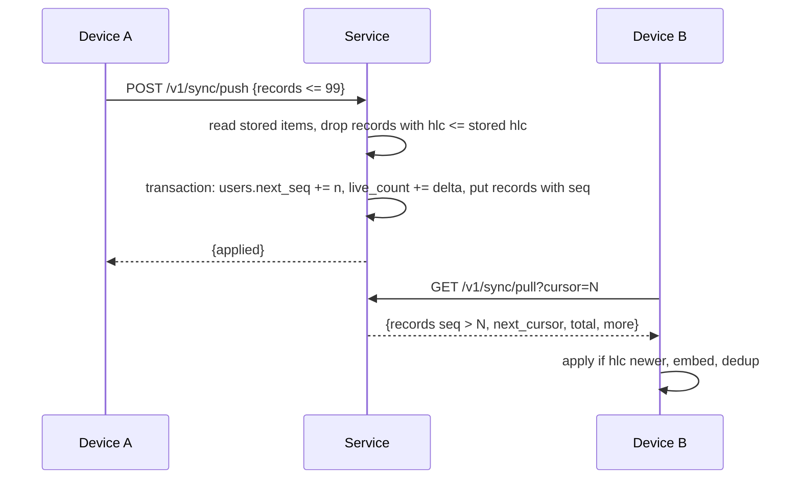

# Loremaster Design

Source: `requirements.md` (P0). Background: `../../NOTES.md`.

## Current State

Today's Agents implement memory systems to help recal user information from sessions. This memory lives on the device the agent runs on: for example, Claude Code auto-memory sits in `~/.claude/projects/<project>/memory/`, documented as not shared across machines. This brings up several pain-points:

1) Switch machines and the agent forgets your memories: preferences, corrections, project facts and past attempts stay behind.

2) Memory dies with the machine: a reformat or lost laptop loses it.

3) Each agent keeps its own memory. A fact told to Claude Code is unknown to Codex, even on the same device.

Some workarounds fall short:
  - Hosted memory APIs (Mem0, Zep, Supermemory): cloud-only, no offline, network latency on recall, need their own setup and keys.
  - File sync of `~/.claude` (Syncthing, git, rclone): copies files without understanding them; corrupts live databases; concurrent edits on two devices lose data.
- No product syncs one user's agent memory across devices and agents.

## Overview

This is a design document for a **Cross-device and cross-agent memory harness for AI agents**. Recall is local; memories sync through a thin AWS service.

A Rust service on each device captures turns via agent hooks, extracts memories through server-held LLM prompts, stores them in SQLite, recalls them locally and syncs latest-state records with last-write-wins.



## Layers
1. **Agent integration**: per-agent adapters to four core verbs.
2. **Client**: `loremasterd` service and `loremaster` CLI. Capture, redaction, recall, embeddings.
3. **Extraction**: turn to memories, reconcile, episodes. Runs on device; LLM calls via service.
4. **Sync**: latest-state records, push/pull, bootstrap.
5. **Service**: API Gateway + one Lambda.
6. **Storage**: DynamoDB (server), SQLite (device).
7. **Identity**: GitHub OAuth device flow + per-device tokens.

---

## 1. Agent Integration Layer

### Purpose
- Connects Loremaster to each supported agent: tells it when a session starts, a prompt arrives, a turn ends, a session ends, and hands memory back into the agent's context.
- Why: hooks are the only mechanism the harness runs every time. Instructions and MCP tools leave memory use to the model. One thin adapter per agent keeps everything else agent-agnostic (FR36, NFR9).

### Design
Core + thin adapters. Each adapter maps its agent's hook events and transcript format to four verbs. Adding an agent adds an adapter only (NFR9).

| Verb | Claude Code event | Does | Budget |
|---|---|---|---|
| `session_start` | SessionStart | return profile, start background pull | NFR2 2 s |
| `recall` | UserPromptSubmit | return relevant memories | NFR1 100 ms |
| `capture` | Stop | hand turn to service, exit | NFR3 50 ms |
| `session_end` | SessionEnd | mark session ended, trigger episode | 1 s |

- Hook command: `loremaster hook <agent> <event>`. Reads hook JSON on stdin (`session_id`, `transcript_path`, `cwd`, `prompt`, `last_assistant_message`). Returns `hookSpecificOutput.additionalContext` for `session_start` and `recall`.
- Adapter: `Adapter` trait in crate `loremaster-agents`. `ClaudeCodeAdapter`. Methods: `parse_event(stdin) -> CoreEvent`, `read_turn(transcript_path, turn) -> Turn` (tool calls from the agent-specific transcript format), `render_context(text) -> stdout`.
- Install: `loremaster setup` / `loremaster enable <agent>` (FR37) merge entries into `~/.claude/settings.json`. Our entries are the ones whose command starts with our binary's path, so uninstall removes exactly ours (FR13). No marker field: unknown keys may fail the agent's config validation.
- Any hook failure or timeout exits 0 with no output. The agent never blocks (FR29).

---

## 2. Client Layer

### Purpose
- Everything that runs on the user's machine: captures turns, strips secrets, holds the local memory copy, and answers recall.
- Why: recall must be fast (100 ms) and work offline (FR4, NFR1), so memory and search live on the device. Secrets must be removed before anything leaves the machine (FR20).

### Design
Two processes from one Rust binary.
- `loremasterd`: long-running service. launchd user agent (macOS), systemd user unit (Linux). Holds embedding model, in-memory vector index, compiled redaction rules. Listens on `~/.loremaster/sock`.
- `loremaster`: CLI. `hook`, `setup`, `login`, `enable`, `status`, `uninstall`, `update`.

### Components in `loremasterd`
- `HookServer`: Unix socket RPC for the four verbs.
- `Redactor`: gitleaks default rules (pinned, embedded at build) + user patterns from `~/.loremaster/config.toml` `[redact] patterns`, hot-reloaded (FR22). Replaces matches with `[REDACTED:<rule-id>]`. CI runs the fixed secret corpus, must hit 100% (FR21).
- `Embedder`: `fastembed`, `bge-small-en-v1.5` quantized ONNX, 384 dims, pinned. Model id stored per row.
- `Index`: all live vectors in memory (~77 MB at 50k), brute-force cosine.
- `Recall`: profile + per-prompt retrieval.
- `Pipeline`: extraction worker (Section 3).
- `SyncClient`: push/pull (Section 4).
- `SessionTracker`: per-session last-turn time, 60 min idle timer for episodes (FR3).
- `ProjectId`: from `cwd`, `remote.origin.url` via `gix`, normalized to `host/owner/repo` (SSH and HTTPS equal). No remote: last path segment. Cached per `cwd`. Same in every agent (FR36).

### Capture (FR14, FR20, NFR3)



- Service down: hook appends a pointer (`agent`, `verb`, `session_id`, `transcript_path`, `cwd`) to `~/.loremaster/spool`. No prompt or reply text. Service replays the spool on start.
- Raw turn text is never written by Loremaster. Redaction happens before `turn_queue`.
- Prepared turn: user prompt, final assistant reply, condensed tool calls (command, files edited, errors). Large tool output, file contents, diffs dropped. Max 32k tokens, oldest content trimmed first.

### Recall: profile at session start (FR23)
- Score = kind weight x 0.5^(age_days/90). Weights: correction 1.0, preference 0.9, decision 0.8, environment 0.7, pitfall 0.6.
- Fill user-scope facts up to 150 tokens, then current-project facts, then remaining user facts, total max 300 tokens. Episodes excluded.

### Recall: per prompt (FR24 to FR28, NFR1)
- 1. Embed prompt.
- 2. Filter: scope user, or project with current project ID (FR26, FR27). Live only: not superseded, not tombstoned (FR9, FR30).
- 3. Cosine score. Episodes x 0.5^(age_days/30) (FR28).
- 4. Keep score >= tau (start 0.6), best first, max 500 tokens, skip memories already injected this session. Nothing passes: inject nothing.
- Hook waits on the socket with a 90 ms deadline, then exits empty (FR29).

---

## 3. Extraction Layer

### Purpose
- Decides what is worth remembering: turns each turn into 0 to 3 durable facts, resolves them against existing memory (skip, add, replace), and writes one episode per session.
- Why: the user never manages memory (US7). Quality of what gets stored drives everything downstream (FR15, FR30, FR31). Replacing stale facts stops the agent acting on old information (US10).

### Design
Runs in `loremasterd`. LLM steps call stateless service endpoints that hold the prompts and call Claude Haiku 5.5. Unprocessed turns stay in `turn_queue` until done (FR19). Offline: turns wait, recall continues (FR4).



- `extract`: prepared turn to `{candidates: [{text, scope, kind}]}`. Most turns return none. Junk rules in the prompt (FR15).
- `reconcile`: candidate + neighbours (id, text) to one decision. SUPERSEDE returns the new fact's text (may combine both facts, max 2,000 chars); device writes it as a new fact and marks the old one `superseded_by` it (FR30). Existing memory text is never edited in place.
- Scope: `user` or `project`; project facts get the session project ID (FR16).
- Text over 2,000 chars rejected (FR18).
- Episode (FR17): on SessionEnd or 60 min idle, `POST /v1/episode` with the session's prepared turns (max 100k tokens) to one project-scoped episode: attempted, worked, failed. Session's queued turns deleted after.
- Post-pull dedup: newly pulled facts with similarity >= 0.95 to a local fact in the same scope: tombstone the larger ULID. Deterministic, so devices converge.
- Thresholds 0.95 / 0.75 and tau are starting values, tuned on the eval set (FR15, FR25, FR31).

---

## 4. Sync Layer

### Purpose
- Moves memories between a user's devices so each one ends up with the same set, including deletes and replacements.
- Why: the core promise is "same memory on every device" (US1, US2). Devices go offline and run in parallel, so sync must never lose a memory, never resurrect a deleted one, and always converge (FR5 to FR9).

### Design
Latest-state records, not an op log. Server keeps one item per memory. Per-record last-write-wins by HLC (FR7). Server-assigned per-user `seq` is the pull cursor, so late pushes from offline devices are never skipped.

### Record
- `memory_id` ULID, `type` fact|episode, `kind` preference|decision|correction|environment|pitfall (facts), `scope` user|project, `project_id`, `text` (max 2,000), `created_at`, `hlc`, `writer` (device id or `server`), `superseded_by`, `deleted` (tombstone), `seq` (server).
- Text and metadata only. Vectors never sync; each device embeds.
- No agent field affects text, scope or project ID (FR36).

### Push and pull



- Push is one `TransactWriteItems`: user item `next_seq` (condition: unchanged) + each record (condition: absent or older `hlc`). Serializes pushes per user, so a visible `seq` is never followed by a lower one. Conflict: re-read, retry.
- `live_count` delta from the stored items read before the transaction: new live record +1, live to tombstone -1, else 0. Exact, because a concurrent push changes `next_seq` and forces re-read and retry.
- Idempotent: re-pushing the same record is a no-op by HLC.
- Tombstones kept forever in P0. Offline devices cannot resurrect (FR9). Cleanup job is P1.
- Tombstones keep only keys, `seq`, `hlc`, `writer`, `deleted`. Text and metadata are removed. See [Appendix A](#appendix-a-dynamodb-memories-table).

### Cadence (FR1, FR2, FR5, FR6)
| Trigger | Action |
|---|---|
| Session start | pull in background; hook does not wait |
| Local write | push immediately |
| Every 5 min | push + pull |
| Service start, network back | push outbox, pull |

- Worst-case fact latency: extraction (seconds) + push + peer's 5 min pull, under 10 min.
- Service unreachable: same as offline (FR8).

### Bootstrap (FR11)
- New device pulls from `cursor=0`. Paged by DynamoDB's 1 MB query limit.
- Each page: store, save cursor, embed, add to index. Resumes from saved cursor after restart.
- Recall and capture work on what is loaded so far.
- Progress from `total`: shown in setup and `loremaster status`.
- Budget: ~100 MB at 50 Mbps ~16 s; embedding 50k dominates, estimated minutes. Measure on a 5-year-old laptop.

---

## 5. Service Layer

### Purpose
- The cloud API devices talk to: device onboarding, sync push/pull, LLM calls for extraction, the 50k cap, and account deletion.
- Why: devices need a shared meeting point to sync through, and the LLM key must stay off devices so users need no API key or extra account (FR19).

### Design
API Gateway HTTP API + one Rust Lambda running the whole `axum` router (via `lambda_http`). One binary, one deploy, one IAM role; timeout sized for the LLM endpoints. Shared crate `loremaster-core` for records, HLC, ULID, API types.

### Endpoints
| Endpoint | In | Out | Errors |
|---|---|---|---|
| `POST /v1/devices` | `github_token`, device name, optional `replace_device_id` | `{device_id, token}` | 401 bad GitHub token, 409 device limit + device list (FR12) |
| `GET /v1/devices` | | device list | |
| `DELETE /v1/devices/{id}` | | 204 | uninstall frees slot (FR13) |
| `POST /v1/sync/push` | records (max 99) | `{applied}` (accepted ids) | 409 retry |
| `GET /v1/sync/pull?cursor=` | | records, `next_cursor`, `total`, `more` | |
| `POST /v1/extract` | prepared turn | candidates | 413 over 32k tokens, 429 daily cap |
| `POST /v1/reconcile` | candidate + neighbours | decision | 429 |
| `POST /v1/episode` | session turns | episode text | 413 over 100k tokens, 429 |
| `DELETE /v1/account` | | 202 | |

- All except `POST /v1/devices` require a device token, checked by `axum` auth middleware: SHA-256 the bearer token, look up `devices`, attach `user_id`. Lookup on every request, so deletion is immediate.
- LLM endpoints: prompts are server-side; devices send data only. Per-user daily input-token counter on the user item; over 5M tokens/day returns 429, device retries next day. API Gateway account throttle as backstop.

### 50k cap (FR33)
- Push updates `users.live_count` (Section 4). Over 50k: push handler queries the eviction GSI oldest-first (replaced facts, then episodes, then other facts) and writes tombstones with `writer = server`, decrementing `live_count` the same way. Devices get them on next pull. No user notification.

### Account deletion (FR34)
- `DELETE /v1/account`, one Lambda:
  - 1. Delete the user's device token items. Auth middleware rejects all devices immediately.
  - 2. Async-invoke itself to batch-delete remaining DDB rows. Idempotent; Lambda async retries.
- No point-in-time recovery, so nothing survives deletion. Local stores untouched.

---

## 6. Storage Layer

### Purpose
- Where data lives: the server copy every device syncs from, and each device's local copy used for recall and offline work.
- Why: the server copy is what a new device bootstraps from and must survive infrastructure failure (NFR6). The local copy keeps recall fast and makes queued turns survive crashes (FR4).

### Server: DynamoDB (on-demand, KMS encryption at rest, NFR7)
| Table | Key | Attributes | Indexes |
|---|---|---|---|
| `users` | `user_id` | `next_seq`, `live_count`, `tokens_day`, `tokens_used` | |
| `devices` | `token_hash` (SHA-256) | `user_id`, `device_id`, `name`, `created_at` | GSI `user_id` |
| `memories` | `user_id`, `memory_id` | record fields | LSI `seq`; sparse GSI `user_id` + `evict_key` (`class#created_at`, live rows only) |

- Full `memories` data model: [Appendix A](#appendix-a-dynamodb-memories-table).
- Multi-AZ replication covers NFR6. No PITR, no S3.
- Every query is keyed by the token's `user_id` (NFR7).

### Device: SQLite (`rusqlite`, WAL) at `~/.loremaster/store.db`
| Table | Purpose |
|---|---|
| `memories` | record fields + `vector` BLOB + `model_id` |
| `turn_queue` | redacted prepared turns, `session_id`, `project_id`, status |
| `sessions` | `session_id`, agent, project, last turn time, ended |
| `outbox` | record ids not yet pushed |
| `sync_state` | cursor, device id, HLC state |
| `injected` | per-session injected memory ids |

- WAL transactions make queue and outbox crash-safe (FR4).
- Not encrypted by Loremaster; relies on OS disk encryption (NFR7). Agent transcripts beside it are unencrypted and unredacted anyway.
- Device token in `~/.loremaster/credentials`, mode 0600.
- Uninstall keeps `store.db` unless `--purge` (FR13).

---

## 7. Identity Layer

### Purpose
- Who the user is and which devices may act for them: signup, browser login, one credential per device, removal of devices and accounts.
- Why: a device must only ever read and write its own user's data (NFR7). Per-device credentials let one device be removed without touching the others (FR13, FR34), and the 10-device limit needs a device registry (FR12).

### Design
Sign in with GitHub via GitHub's OAuth device flow, so login works over SSH. GitHub hosts the code page and login; first login is signup. A GitHub account is required.

```mermaid
sequenceDiagram
  participant C as loremaster login
  participant G as GitHub
  participant B as Browser
  participant S as Service
  C->>G: POST /login/device/code {client_id}
  G-->>C: {device_code, user_code, verification_uri, interval}
  C->>C: print URL + user_code
  B->>G: enter code, authorize app
  loop every interval
    C->>G: POST /login/oauth/access_token {device_code}
  end
  G-->>C: github_token
  C->>S: POST /v1/devices {github_token, name, replace_device_id?}
  S->>G: GET /user (github_token)
  G-->>S: {id, login}
  S->>S: user_id = gh:<id>; create user if new; count devices < 10 (or delete replace_device_id), create device + token
  S-->>C: {device_id, token}
  C->>C: drop github_token, save token
```

- GitHub OAuth App: device flow enabled, no scopes. Public client ID embedded in the CLI; no server-side secret.
- `user_id` = `gh:<numeric GitHub id>`, stable across username changes.
- GitHub token used once to read `GET /user`, then discarded by CLI and server. Not revoked (would need a client secret); with no scopes it reads only public profile.
- GitHub outage blocks new logins only; existing devices use our tokens.

- Token: random 256-bit, stored only as SHA-256 hash. One per device.
- Device limit (FR12): on 409 the CLI lists devices and asks which to replace, then retries with `replace_device_id` and the same GitHub token. Old token delete and new device create in one transaction. Covers reformatted or lost devices that never ran uninstall.
- Auth middleware: looks up the hash per request, no cache, so deletion is immediate.
- TLS on all traffic (NFR7).

---

## Setup Flow (F1, F2, FR10)
- 1. `curl -fsSL https://github.com/<org>/loremaster/releases/latest/download/install.sh | sh`: detect OS/arch, download binary from the same GitHub Release, verify SHA-256, install to `~/.loremaster/bin`.
- 2. `loremaster setup`: login (Section 7), install service unit, detect agents, write hooks.
- 3. Bootstrap pull with progress (Section 4).
- Builds: GitHub Actions for macOS arm64, Linux x86_64/arm64 (NFR8). No Intel Mac: `ort` ships no prebuilt ONNX Runtime for `x86_64-apple-darwin`.

## Infrastructure
- AWS SAM: one `infra/template.yaml` (HTTP API, Lambda, DynamoDB tables, IAM role). `sam build` compiles the Lambda with `cargo-lambda`. `sam deploy --resolve-s3`, config envs `dev` and `prod` in `samconfig.toml`.
- GitHub OAuth App created once by hand in GitHub settings.
- No custom domain in P0. Clients use the default API Gateway URL: built into the binary, overridable as `api_url` in `~/.loremaster/config.toml`. Prod API has `DeletionPolicy: Retain` so the URL never changes.

## Test Tooling
- Local service: `cargo lambda watch` serves the Lambda on `localhost:9000` with hot rebuild; DynamoDB Local for tables. `loremasterd` points at it via config.
- Dev stack: `sam sync --watch --config-env dev` pushes code changes to a personal AWS stack in seconds.
- `loremaster dev seed <file.jsonl>`: writes memories straight into SQLite. Used to test recall and NFR1 at 50k before extraction exists. Dev builds only.
- `loremaster dev eval <dir>`: replays the labeled eval set through capture, extract, reconcile and recall. Scores FR15, FR25, FR26, FR31. Used to tune OQ4 values.

## Key Decisions
- D1. Extraction LLM is server-paid Claude Haiku 5.5. Alt: headless `claude -p`. Why: agent-independent output (FR36), no user quota or key (FR19). Est. $1 to $3 per user per month. Sonnet 5.5 only if eval fails.
- D2. Extraction pipeline on device, stateless LLM endpoints on server. Alt: server pipeline. Why: device already has store and index; server stays thin with no vector index.
- D3. Rust on device and server. Alt: Go, TypeScript. Why: fast hook startup, mature local embedding stack, shared types.
- D4. API Gateway + one Lambda with auth middleware. Alt: ECS Fargate; per-route Lambdas + Lambda authorizer. Why: short stateless bursty requests, scales to zero; one function is fewest moving parts.
- D5. DynamoDB. Alt: Aurora Serverless v2, DSQL. Why: no connection pooling or VPC with Lambda, multi-AZ built in, access is always by user.
- D6. Latest-state table with server `seq`. Alt: append-only op log + snapshots. Why: LWW needs no history; no snapshots, compaction or S3.
- D7. Long-running `loremasterd` + thin hook CLI. Alt: hook-only. Why: model load does not fit 100 ms; sync and idle episodes need a running process.
- D8. Local `bge-small-en-v1.5` embeddings (English). Alt: API embeddings, `multilingual-e5-small`. Why: offline recall (FR4), 100 ms budget (NFR1), fastest bootstrap embedding (FR11). Known limit: weaker recall for non-English text. Model can change later by local re-embed (`model_id` per row), no server change.
- D9. SQLite + in-memory brute-force search. Alt: LanceDB, `sqlite-vec`. Why: crash-safe queue; exact search is fast at 50k.
- D10. GitHub OAuth device flow + opaque per-device tokens. Alt: Cognito + own device-code flow, Auth0/Clerk/Supabase. Why: free, works over SSH, GitHub hosts code entry and login (no Cognito, `device_codes` table, approve or callback pages); target users have GitHub accounts. Immediate per-device revocation.
- D11. Hooks merged into user-level agent config. Alt: plugins. Why: applies to all projects, no marketplace.
- D12. Redaction in `loremasterd` with gitleaks rules. Alt: in hook process. Why: precompiled rules keep capture under 50 ms.
- D13. Server enforces 50k cap. Alt: devices. Why: only the server sees the full current set.
- D14. Tombstones kept forever in P0. Alt: 180-day purge + full resync. Why: simplest; cleanup in P1.
- D15. Account deletion in one Lambda, no PITR. Alt: scheduled job + PITR window. Why: fewest moving parts; no restore after our own bugs.
- D17. Contradicting facts created concurrently on two devices both survive in P0 (FR30 exception). Alt: post-pull reconcile by the newer fact's writer. Why: rare, users seldom work on two devices at once; no extra sync logic.
- D18. AWS SAM for infrastructure. Alt: CDK, Terraform. Why: one YAML file for a small fixed serverless stack; no Node, bootstrap or state backend; built-in local emulation.
- D19. NFR5 met by managed-service SLAs (API Gateway ~99.95%, Lambda ~99.95%, DynamoDB ~99.99%; combined ~99.89%). No alarms or monitoring in P0. Alt: CloudWatch 5xx alarm, synthetic canary. Why: simplest; Anthropic and GitHub outages do not affect sync (turns queue, logins only).
- D20. Manual `loremaster update` only (download, verify SHA-256, replace binary, restart service). `/v1` stays backward compatible; breaking changes go to `/v2`. Alt: daily auto-update. Why: no self-replacing binary or rollback path; a bad release cannot reach every device unattended.

## P1: Codex CLI
Moved out of P0. Parked code and fixtures: `p1-codex/`.
- Codex events match the Claude Code ones. Hooks go in `~/.codex/hooks.json`.
- Codex needs user approval of new hooks in `/hooks`, recorded against a hash of the hook definition. Setup ends with "Open Codex, run `/hooks`, approve Loremaster". Entries are written byte-identical, so approval is not re-requested. `loremaster status` warns while no Codex hook event has been received.
- D16. Codex hook approval is a user step. Alt: managed hooks via `requirements.toml`, or writing Codex trust state directly. Why: approval is Codex's security control; managed hooks are for enterprise admins; trust state is undocumented.

## Open Questions
- OQ4. Tunables (tau, kind weights, 0.95/0.75, token caps, 5M/day) to be set from the eval set and real usage.

---

## Appendix A: DynamoDB `memories` table

One item per memory: its latest version, or a tombstone.

### Keys and indexes
| Role | Attribute | Type |
|---|---|---|
| Partition key | `user_id` | S (`gh:<GitHub id>`) |
| Sort key | `memory_id` | S (ULID) |
| LSI sort key | `seq` | N |
| Sparse GSI | `user_id` + `evict_key` | S |

### Attributes
| Attribute | Type | Notes |
|---|---|---|
| `seq` | N | per-user server counter, pull cursor |
| `hlc` | S | fixed width `<wall_ms:13>-<counter:5>-<writer>`, so string compare orders it in LWW conditions |
| `writer` | S | device id, or `server` for cap evictions |
| `type` | S | `fact` or `episode` |
| `kind` | S | facts only: `preference`, `decision`, `correction`, `environment`, `pitfall` |
| `scope` | S | `user` or `project` |
| `project_id` | S | project scope only, e.g. `github.com/a/b` |
| `text` | S | max 2,000 chars |
| `created_at` | N | epoch ms |
| `superseded_by` | S | `memory_id` of the replacing fact; absent if current |
| `deleted` | BOOL | `true` = tombstone |
| `evict_key` | S | `<class>#<created_at>`, class `1` replaced fact, `2` episode, `3` other fact. Non-deleted items only |

### Example
```json
{
  "user_id": "u_7f3c...",
  "memory_id": "01JBQ8Z6K4M2T9X0R5N7C3V1HD",
  "seq": 4182,
  "hlc": "1761750000123-00002-dev_a1b2",
  "writer": "dev_a1b2",
  "type": "fact",
  "kind": "preference",
  "scope": "user",
  "text": "Prefers pnpm over npm",
  "created_at": 1761750000123,
  "evict_key": "3#1761750000123"
}
```

### Tombstones
- Keep only `user_id`, `memory_id`, `seq`, `hlc`, `writer`, `deleted: true`.
- `text`, `kind`, `scope`, `project_id`, `superseded_by`, `evict_key` removed. Deleted text leaves the server; tombstones kept forever stay small.

### Access patterns
| Access | Operation |
|---|---|
| Pull | Query LSI: `user_id = :u AND seq > :cursor` |
| Push | Put with condition `attribute_not_exists(memory_id) OR hlc < :hlc`, in one transaction with `users.next_seq` |
| Cap eviction (FR33) | Query GSI: `user_id = :u`, ascending `evict_key` (replaced, then episodes, then facts, oldest first) |
| Account delete (FR34) | Query `user_id = :u`, batch delete |

### Limits
- LSI must be defined at table creation.
- LSI caps each user's data at 10 GB. Max per user is ~100 MB (50k x 2 KB).
