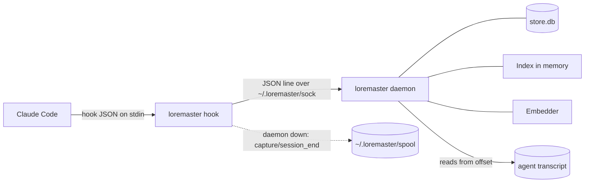

# M1. Local Client Core — Design

Source: `../milestones.md` M1, `../design.md` Sections 1, 2, 6 (device), `../requirements.md`. Refines the project design; does not change it.

## Overview
- `loremasterd` + hook CLI on one device, no server. Claude Code gets a profile at session start and relevant memories per prompt from local memory; every turn is captured, redacted and queued in `turn_queue`.
- One Rust binary. Hooks relay agent JSON over a Unix socket to a long-running daemon that holds the store, embedding model, vector index and redaction rules.



## Workspace
- `crates/loremaster`: the binary. CLI subcommands and `loremaster daemon` (the `loremasterd` process). Modules: `hook`, `server` (`HookServer`), `redact` (`Redactor`), `embed` (`Embedder`), `index` (`Index`), `recall` (`Recall`), `project` (`ProjectId`), `store`, `spool`, `config`, `enable`, `dev`.
- `crates/loremaster-agents`: `Adapter` trait, `ClaudeCodeAdapter`. The trait stays with one implementation because adding an agent must add an adapter only (NFR9); Codex is the next in P1.
- `crates/loremaster-core`: `Record`, ULID, HLC. Reused by the service from M2.
- Daemon on `tokio`. Hook path uses blocking std I/O for fast start.
- `dev` Cargo feature gates `dev seed` and `dev bench`; off in release builds.

## Files (`~/.loremaster/`)
| Path | Content |
|---|---|
| `bin/loremaster` | binary |
| `sock` | Unix socket |
| `store.db` | SQLite, WAL |
| `store.db.lock` | file lock held during store setup; SQLite reports busy at once when two connections switch a new database to WAL |
| `daemon.lock` | file lock held by the running daemon |
| `spool` | JSONL pointers written while daemon is down |
| `config.toml` | `[redact] patterns = ["<regex>", ...]` |
| `models/bge-small-en-v1.5-q/` | embedding model files |
| `logs/loremasterd.log` | `tracing` output |

## Components
- `HookServer`: accepts socket connections, one request per connection, dispatches the four verbs.
- `Adapter` (per agent): `parse_event(json) -> CoreEvent`, `read_turn(path, offset) -> (Turn, next_offset)`, `render_context(event, text) -> stdout`. Transcript schemas taken from captured real-session fixtures in `crates/loremaster-agents/tests/fixtures/`.
- `Redactor`: gitleaks `config/gitleaks.toml` (222 rules, pinned commit, `include_str!`, compiled on first use, with their end-of-token match widened so forms like `curl -u sk_test_...:` are found), plus built-in rules for what gitleaks misses (connection-string passwords, password assignments and flags, Basic auth headers, AWS secret keys starting with `/` or `+`, Google access tokens, OpenAI project keys of unlisted lengths, private keys with no END line), plus user patterns as `custom-<n>`. Keyword prefilter (`aho-corasick`), regex (`regex`; gitleaks rules use no lookaround), entropy threshold per rule. Replaces the secret with `[REDACTED:<rule-id>]`. Checks `config.toml` mtime before each call; on change recompiles user patterns; invalid pattern keeps previous rules and logs (FR22).
- `Embedder`: `fastembed` 7.5.0, `default-features = false`, features `ort-download-binaries-native-tls` (no `hf-hub`). Loads `Qdrant/bge-small-en-v1.5-onnx-Q` at commit `aa8f8b060edb00e03bfdd08813a2949946c8ba55` via the user-defined-model API, CLS pooling, normalized, 384 dims. `model_id = "bge-small-en-v1.5-q"`. Single instance behind a `Mutex`, called in `spawn_blocking`.
- Model download: on daemon start, if files missing, fetch `model_optimized.onnx`, `tokenizer.json`, `config.json`, `special_tokens_map.json`, `tokenizer_config.json` from `https://huggingface.co/Qdrant/bge-small-en-v1.5-onnx-Q/resolve/<commit>/<file>`, verify SHA-256 pinned in code, write atomically. Until loaded: recall returns nothing; profile and capture work.
- `Index`: contiguous `Vec<f32>` (n x 384) plus parallel metadata (`memory_id`, `type`, `kind`, `scope`, `project_id`, `created_at`, `live`, est. tokens), behind `RwLock`. Loaded from `memories` at start. Search = dot product over rows passing the filter. Rows with a different `model_id` re-embedded in background.
- `Recall`: `profile(project_id)` and `for_prompt(session_id, project_id, prompt)`, each returning the text and the memory ids used. Scoring, filters, caps per project design Section 2. The daemon records those ids in `injected` after delivery, so a memory in the profile is not injected again on a prompt.
- `ProjectId`: `gix` reads `remote.origin.url` from the repo containing `cwd`. Normalize: lowercase host; strip scheme, `user@`, port, trailing `.git` and `/`; owner and repo keep case. `git@github.com:A/b.git` and `https://github.com/A/b` give `github.com/A/b`. No remote or no repo: last path segment of `cwd`. Cached per `cwd`.
- `Store`: one `rusqlite` connection owned by one task; schema via `PRAGMA user_version` + numbered SQL steps embedded in the binary.
- Token estimate everywhere (caps 300, 500, 32k): `ceil(chars / 3)`.

## Data Model (`store.db`)
| Table | Columns | Notes |
|---|---|---|
| `memories` | `memory_id` TEXT PK, `type`, `kind`, `scope`, `project_id`, `text`, `created_at` INT, `hlc`, `writer`, `superseded_by`, `deleted` INT, `seq` INT NULL, `vector` BLOB (384 x f32 LE), `model_id` | index `(scope, project_id)` |
| `turn_queue` | `id` INT PK, `session_id`, `agent`, `project_id`, `turn` TEXT (redacted prepared turn JSON), `created_at`, `status` (`pending`/`done`) | |
| `sessions` | `session_id` PK, `agent`, `project_id`, `transcript_path`, `transcript_offset` INT, `last_turn_at`, `ended` INT | |
| `outbox` | `memory_id` PK | used from M3 |
| `sync_state` | `key` PK, `value` | `cursor`, `device_id`, `hlc` from M3 |
| `injected` | `session_id`, `memory_id`, PK both | |

- Prepared turn JSON: `{prompt, tool_calls: [{tool, command?, files?, error?}], reply}`. `command` and `error` truncated to 500 chars; tool output, file contents, diffs dropped. Over 32k est. tokens: oldest tool calls trimmed first.

## Interfaces

### CLI
- `loremaster hook claude-code <SessionStart|UserPromptSubmit|Stop|SessionEnd>`: stdin hook JSON, stdout per adapter. Always exits 0.
- `loremaster daemon`: runs `loremasterd`. M1: started by hand or tests; service unit in M5.
- `loremaster enable claude-code`: writes hook entries (below), and links this binary at `bin/loremaster` if nothing usable is there, replacing a dangling link. `install.sh` takes this over in M5.
- `loremaster dev seed <file.jsonl>`: one `Record` per line without vector; embeds with the real model; fills missing `memory_id`, `created_at`, `hlc`.
- `loremaster dev bench`: temp home, 50k memories with random unit vectors, starts daemon, runs each hook verb 1,000 times as child processes with real hook JSON, plus recall with an 800-word prompt, prints P50/P95, exits non-zero over budget. Fails too if more than 5% of recalls return nothing or captures spool, because the hook's own deadline would otherwise hide a timeout. The first rows are exact matches for the measured prompts.

### Socket protocol
- One request per connection, newline-delimited JSON.
- Request: `{"verb": "session_start"|"recall"|"capture"|"session_end", "agent": "claude-code", "event": <agent hook JSON, unparsed>}`.
- Response: `{"additional_context": "..."}` or `{}`. Unparseable request: `{}`.

| Verb | Hook deadline | Daemon replies |
|---|---|---|
| `session_start` | 1 s | after profile built |
| `recall` | 90 ms | after search |
| `capture` | 40 ms | on receipt, then processes |
| `session_end` | 1 s | on receipt, then processes |

- Socket missing, connect fails or deadline passes: `session_start`/`recall` exit with no output; `capture`/`session_end` append `{agent, verb, session_id, transcript_path, cwd}` to `spool` (`O_APPEND`) and exit 0. No prompt or reply text in the spool.

### Hook entries (`enable`)
- File: `~/.claude/settings.json`. Merged; other hooks untouched. Written via temp file, fsync and rename, keeping the file's permissions and following a symlink.
- Command: absolute path, `<home>/.loremaster/bin/loremaster hook <agent> <event>`. Ours = command starts with `<home>/.loremaster/bin/loremaster hook `. No marker field.
- No matcher (SessionStart also fires on resume, clear, compact).
| Event | `timeout` (s) | `async` |
|---|---|---|
| SessionStart | 5 | no |
| UserPromptSubmit | 2 | no |
| Stop | 10 | yes |
| SessionEnd | 3 | no |
- Stable key order, byte-identical output on every run.
- A path that needs it is shell-quoted. When `LOREMASTER_HOME` is set away from the default, the command starts with `LOREMASTER_HOME=<path> `, so an agent started elsewhere reaches the same home; "ours" then means the command starts with that whole prefix.

### Injected text
Profile:
```
Loremaster memory from past sessions. Newer user instructions override it.
User:
- [preference] Prefers pnpm over npm
Project github.com/acme/web:
- [decision] Deploys go through ArgoCD, not manual kubectl
```
Per prompt:
```
Loremaster memories relevant to this prompt:
- [correction] Don't mock the database in integration tests
- [episode, 12 days ago] Tried upgrading to Vite 6; build failed on the SSR plugin; reverted
```
- Header and tags count toward the caps. Age shown on episodes only. Empty result: no output.
- Wrapped by `render_context` as `{"hookSpecificOutput": {"hookEventName": "<event>", "additionalContext": "<text>"}}` .

## Flows
- **session_start**: parse event, `ProjectId` from `cwd`, upsert `sessions` (offset 0 if new), `Recall::profile`, reply.
- **recall**: parse, `ProjectId`, embed prompt, `Recall::for_prompt`, reply. Nothing passes tau: `{}`.
- **capture**: reply `{}`, then: load session (create if missing, offset 0); read every unread turn from `transcript_offset` to the last complete line. For each turn: redact, condense, and in one transaction insert one `turn_queue` row (pending) and advance `transcript_offset` and `last_turn_at`. Turns are never merged. The last turn's reply is `last_assistant_message`, else from the transcript. With no final message, a last turn with no reply yet waits for a later read. A turn after the one the final message belongs to also waits. A prompt typed mid-turn, which Claude Code may record only as a `queued_command` attachment, is its own turn. Harness lines (task notifications, interruption markers, API errors, argument-less commands) are not turn content. Later output with no prompt or tool calls is consumed without a row.
- **session_end**: reply `{}`, then capture anything after the offset, including a last turn with no reply, set `ended = 1`. Episode trigger arrives in M4.
- **spool replay**: on daemon start, before accepting connections, process each spool line as its verb. Lines that hit a passing failure, such as a full disk, stay in the spool; hopeless ones, such as a missing transcript, are dropped.
- **catch-up**: after replay, capture from every session not ended whose transcript still exists. A daemon killed just after replying to a session's last event has nothing else to prompt it. If the transcript changed in the last 60 s, the session may be mid-turn, so its last turn waits for its own Stop.
- **failed job while running**: a capture or session end that hits a passing failure is appended to the spool for the next start.
- **single daemon**: `daemon.lock` in the home, held with a file lock, released by the system however the process ends.
- **compaction**: SessionStart with `source` `compact` or `clear` clears that session's `injected` rows, because the agent's context has lost those memories.
- **injected marking**: a memory is marked injected only after its reply was written to the hook. A hook past its deadline has gone, so the write fails and the memory stays eligible.
- Crash anywhere before the transaction commits: offset not advanced, next capture or session end re-reads the missed content (FR4).

## Failure behaviour
- Oversized turn: oldest tool calls first, then the prompt from its start, then the reply from its start, until within 32k est. tokens.
- Recall: at most 200 candidates above tau are looked up. Only the last 500 characters of a prompt are embedded.
- Daemon: accept failures are logged and retried after 100 ms. A client that sends nothing is disconnected after 5 s. The home is set to mode 0700. Unreadable or wrong-size memory rows are skipped and logged.
- Hooks: any failure (bad stdin, unknown agent or event, daemon down, timeout, bad reply, unwritable spool) is exit 0, empty stdout (FR29).
- Hook JSON: unknown extra fields ignored; missing `session_id` rejected.
- Transcript: missing file logs and skips (offset unchanged); invalid line skipped; offset past end of file (file replaced) restarts at 0; a hook event with no `transcript_path` captures `last_assistant_message` alone.
- Store: schema newer than the binary, or not a database: daemon exits 1 with a message, file untouched.
- Daemon: second instance exits 1; malformed spool lines skipped; write failure rolls back with offset unchanged.
- Model: download failure logged, retried on next daemon start; partial files deleted. Without the model, recall returns nothing; profile and capture work.
- Redaction: invalid `config.toml` keeps gitleaks + built-in rules; all embedded gitleaks rules compile-tested.
- `enable`: unparseable settings, unexpected `hooks` shape, or missing agent dir: exit 1, file untouched. Writes via temp file + rename.
- `dev seed`: validates the whole file first; any bad line seeds nothing, exit 1.

## Local run
- Sandbox: `LOREMASTER_HOME=/tmp/lm-sandbox`; never touches `~/.loremaster`.
- Start: `cargo run --features dev -- daemon &`, then `cargo run --features dev -- dev seed scripts/samples.jsonl`.
- Drive: pipe agent hook JSON into `loremaster hook <agent> <event>`; stdout is exactly what the agent receives. `scripts/try-hook.sh` sends one fixture event per verb and prints each output.
- Inspect: `sqlite3 $LOREMASTER_HOME/store.db` (`turn_queue`, `sessions`, `injected`), `tail -f $LOREMASTER_HOME/logs/loremasterd.log`.
- Live agents: `loremaster enable claude-code` against real configs; hooks exit 0 silently if the dev daemon is down. Remove by deleting our hook entries until `uninstall` (M5).
- `/verify` uses this recipe for black-box checks.

## Verification (exit criteria)
- NFR1, NFR3: `dev bench` on a developer laptop is the pass or fail. It does not run in CI, because shared runners are too noisy for wall-clock limits. `capture` measured even though `async` hides it.
- FR21, FR22: `tests/secrets/corpus.jsonl` (~50 lines `{category, text, secret}`: cloud keys, GitHub/Slack/Stripe/OpenAI/Anthropic tokens, PEM keys, JWTs, connection-string passwords). Pass = no `secret` survives. Custom pattern written to `config.toml`, next redaction applies it.
- FR23, FR24: profile and per-prompt output never over 300 / 500 est. tokens; prompt with no match gives no output.
- FR26, FR36: `ProjectId` unit tests (SSH vs HTTPS, port, `.git`, no remote); seeded project-X memory never returned in project Y.
- FR4, FR29: integration test: start daemon, run hooks, `kill -9` daemon, run Stop and SessionEnd hooks (spooled, exit 0, no output), restart, assert every turn in `turn_queue`.
- FR9, FR30: seeded superseded and tombstoned rows never injected.
- Adapter: fixture transcripts; parse each event and turn.

## Key Decisions
- D1. One binary, daemon as `loremaster daemon` subcommand. Alt: two binaries, argv[0] dispatch. Why: one artifact, no tricks.
- D2. Crates `loremaster`, `loremaster-agents`, `loremaster-core`. Alt: one crate per component. Why: split only where shared or agent-specific.
- D3. Token estimate `ceil(chars / 3)`. Alt: bge tokenizer, tiktoken. Why: no tokenizer matches every agent; overestimates English, so caps hold; free.
- D4. Newline JSON, one request per connection, daemon parses agent JSON. Alt: protobuf, bincode, HTTP over socket. Why: one dependency, debuggable, thin hook.
- D5. Injected text: header + `[kind]` bullets, age on episodes only. Alt: plain bullets. Why: source and override rule clear to the model; kind weights corrections.
- D6. Turn boundaries by per-session transcript byte offset, advanced in the same transaction as the queue insert. Alt: message uuids. Why: agent-independent; crash loses nothing.
- D7. Own secret corpus + built-in connection-string rule. Alt: gitleaks test cases. Why: fixed, versioned, covers FR21 categories gitleaks lacks.
- D8. Config reload by mtime check per redaction. Alt: file watcher. Why: no thread or dependency.
- D9. `dev bench` spawns real hook processes against 50k random-vector memories. Alt: criterion. Why: measures what the agent waits for; seeds in seconds.
- D10. Model downloaded by the daemon from a pinned Hugging Face commit, SHA-256 checked. Alt: `include_bytes!`, `hf-hub`. Why: ~30 MB binary, fast dev builds, no hosting, identical everywhere.
- D11. Stop hook `async: true`. Alt: synchronous. Why: capture adds ~0 ms; offsets cover a killed async hook.
- D12. Hook command is the absolute binary path; ours identified by command prefix. Alt: bare `loremaster` on PATH, marker field. Why: agents launched from IDEs or apps often lack the shell PATH; unknown fields may fail validation.

## Open Questions
- None. Tunables (tau, kind weights) remain project design OQ4, set in M4.
